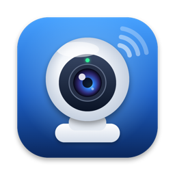
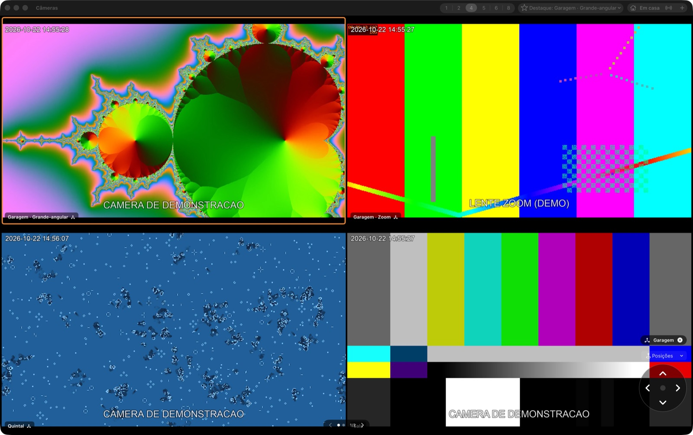
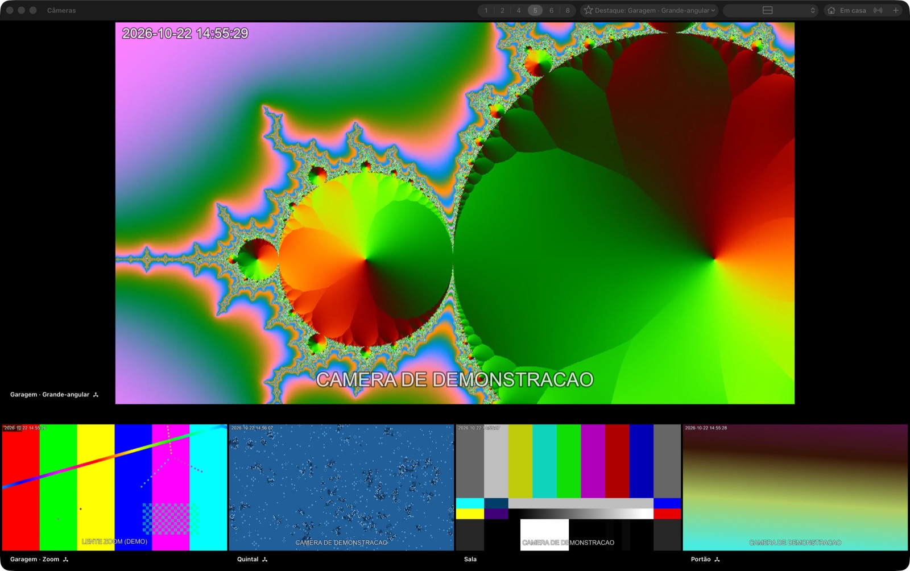
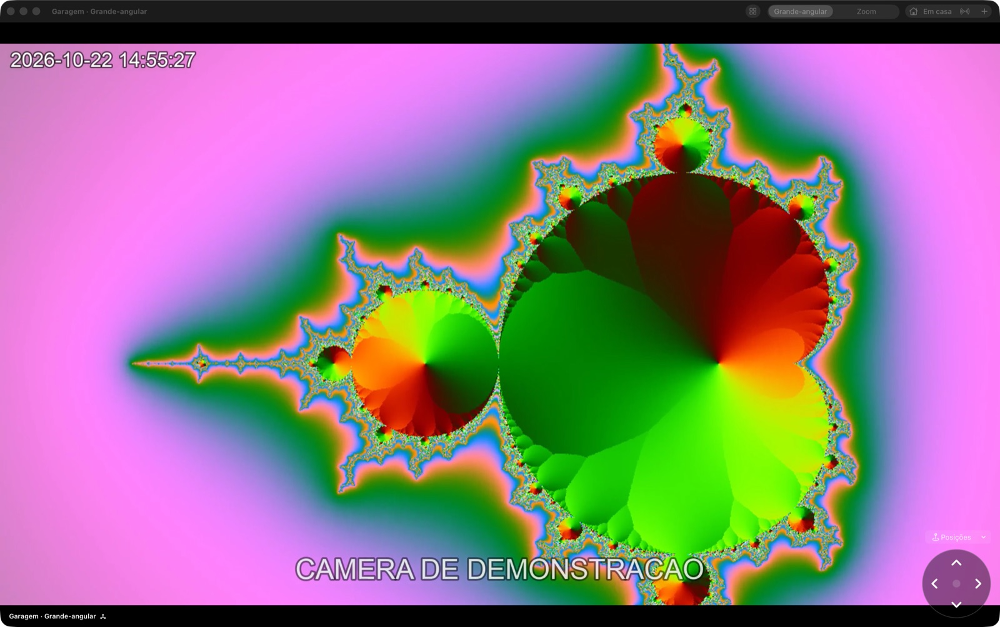
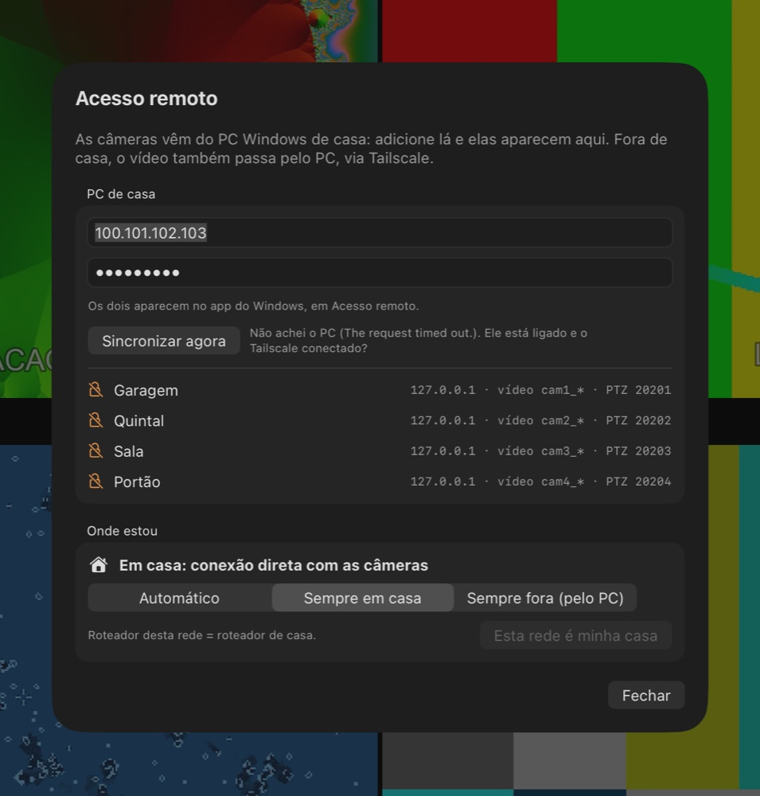
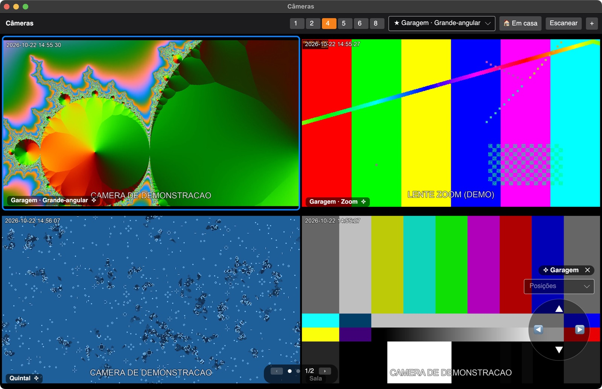
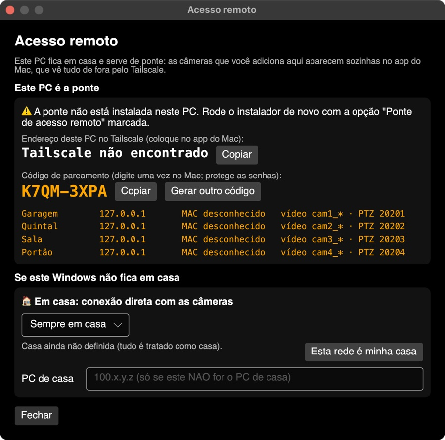

<p align="center"></p>

<h1 align="center">Câmeras Tapo</h1>

<p align="center">
App nativo para <b>macOS</b> e <b>Windows</b> para ver e controlar câmeras TP-Link Tapo pela rede local,
em casa ou de fora (via Tailscale), sem nuvem e sem abrir portas no roteador.
</p>

> As imagens deste README usam **câmeras de demonstração** (padrões de teste gerados no computador).



## Recursos

- **Grade de 1, 2, 4, 5, 6 ou 8 câmeras por tela**, com páginas que passam para o lado (setas, trackpad ou botões).
  O modo 5 tem três arranjos: 1 grande + 4 à direita, 1 grande + 4 embaixo, 3 em cima + 2 embaixo.
- **Câmera em destaque**: escolha qual fica na primeira posição (a grande, nos arranjos com destaque).
- **Câmeras com duas lentes** (ex.: C245D): cada lente vira um quadro; na tela cheia troca-se a lente no topo.
- **PTZ (mover a câmera)** na grade e na tela cheia: clique para selecionar a câmera, mexa com as setas da tela
  ou do teclado, e vá para as **posições salvas** no app Tapo.
- **Alta qualidade** sempre, decodificação por **hardware** no Mac (VideoToolbox) e buffer anti-tremida para Wi-Fi.
- **Escanear a rede** e identificar câmeras Tapo/TP-Link; **detecção automática** de duas lentes e PTZ.
- **PC de casa como ponte**: as câmeras cadastradas no Windows aparecem sozinhas no Mac (com as senhas,
  criptografadas), e o PC **retransmite** o vídeo — cada câmera recebe uma conexão só por lente, não importa
  quantos apps estejam abertos.
- **Fora de casa** pelo Tailscale, mesmo com CGNAT e mesmo que a rede do trabalho use a mesma faixa de IP de casa.
- **FFmpeg embutido** nos dois apps (compilado do código-fonte, mínimo, LGPL). Nada para instalar além do app.

## Prints

| Mac — grade | Mac — modo 5 (1 grande + 4 embaixo) |
|---|---|
|  |  |

| Mac — tela cheia com PTZ | Mac — acesso remoto |
|---|---|
|  |  |

| Windows — grade com PTZ | Windows — acesso remoto (código de pareamento) |
|---|---|
|  |  |

<sub>Os prints do Windows foram feitos com o app rodando no Mac durante o desenvolvimento (por isso a moldura da janela).</sub>

## Como funciona

```
                 rede de casa                                         em qualquer lugar
 ┌────────────┐   RTSP/ONVIF   ┌──────────────────────────────┐      Tailscale       ┌─────────────┐
 │ Câmeras    │ ─────────────▶ │ PC Windows (fica ligado)      │ ◀──────────────────▶ │ Mac         │
 │ Tapo       │                │  • app Câmeras Tapo           │   (criptografado)    │  app        │
 │            │ ◀── PTZ ────── │  • ponte (serviço do Windows) │                      │  Câmeras    │
 └────────────┘                │  • go2rtc (retransmissão)     │                      └─────────────┘
                               └──────────────────────────────┘
```

1. **As câmeras** falam RTSP (vídeo) e ONVIF (movimento). É preciso criar a **Conta da câmera** no app Tapo
   (Configurações avançadas → Conta da câmera) — não é a conta TP-Link.
2. **O app do Windows** (no PC de casa) é o dono da lista de câmeras. Ao adicionar/editar uma câmera, ele grava
   `C:\ProgramData\CamerasTapo\bridge.json` (sem senhas em texto puro).
3. **A ponte** (serviço instalado pelo instalador) lê esse arquivo e:
   - acha cada câmera pelo **MAC**, mesmo que o IP mude (não precisa da senha do roteador);
   - mantém o **go2rtc** retransmitindo o vídeo em `rtsp://<PC>:8554/cam<n>_<lente>` — ele puxa cada lente uma
     única vez e só enquanto alguém assiste;
   - repassa o **ONVIF** (PTZ) de cada câmera na porta `20200+n`;
   - serve a lista de câmeras em `http://<PC>:20200/cameras` para o Mac sincronizar;
   - aceita conexões **somente do Tailscale** (`100.64.0.0/10`).
4. **O Mac** sincroniza a lista com o PC (ao abrir, quando a rede muda e a cada 5 minutos) e assiste pela
   retransmissão. Em casa, o PTZ vai direto na câmera; fora, pela ponte.

### Câmeras Tapo: endereços usados

| | Alta qualidade | Leve |
|---|---|---|
| Lente principal (grande-angular) | `rtsp://usuário:senha@IP:554/stream1` | `/stream2` |
| Segunda lente (zoom, câmeras de duas lentes) | `/stream6` | `/stream7` |
| ONVIF (PTZ e posições salvas) | `http://IP:2020/onvif/device_service` | |

Cada Tapo aceita poucas conexões de vídeo simultâneas (a C245D, 3). A retransmissão do PC resolve isso.

### Segurança

- Nenhuma porta é aberta no roteador; o acesso de fora é só pelo Tailscale (criptografado, funciona com CGNAT).
- **Mac**: senhas no Keychain. **Windows**: senhas protegidas pelo Windows (DPAPI, usuário).
- **Mac ↔ PC**: as senhas viajam criptografadas com o **código de pareamento** (PBKDF2-SHA256 + AES-256-GCM).
  O código aparece só no app do Windows e é digitado uma vez no Mac.
- **Retransmissão**: protegida por senha derivada do código de pareamento (nunca enviada pela rede). As senhas das
  câmeras ficam no PC protegidas pelo DPAPI (máquina) numa pasta que só o sistema e administradores leem.

## App do Mac

Requisitos: Mac com Apple Silicon, macOS 15 ou mais novo.

**Usar**

- **Clique simples** numa câmera: seleciona (borda azul). Se ela tem PTZ, aparece o controle no canto
  (setas + **Posições**). **Setas do teclado** movem a câmera selecionada; **Esc** tira a seleção.
- **Duplo clique**: tela cheia em alta qualidade, com PTZ e troca de lente (câmeras de duas lentes). **Esc** volta.
- Sem câmera selecionada, **← →** ou dois dedos no trackpad trocam de página.
- Topo: modos de grade, arranjo do modo 5, **Destaque**, **Em casa / Fora** (acesso remoto) e **Sincronizar**.
- Sem PC configurado, dá para usar sozinho: **Escanear** → **Adicionar** (com **Detectar automaticamente**).

**Conectar ao PC de casa**: botão **Em casa / Fora** → cole o endereço do PC no Tailscale (`100.x.y.z`) e o
código de pareamento (os dois aparecem no app do Windows, em **Acesso remoto**). Enquanto sincronizado,
adicionar/editar câmeras é feito só no PC.

**Em casa ou fora**: o app reconhece a casa pelo **MAC do roteador** (não pelo IP), então funciona mesmo se o
trabalho usar a mesma faixa de IP. Modo **Automático**, **Sempre em casa** ou **Sempre fora**.

**Dados**: lista em `~/Library/Application Support/TapoCam/cameras.json`, senhas e código de pareamento no
Keychain, log da sincronização em `~/Library/Application Support/TapoCam/sync.log`.

**Compilar**

```bash
./build.sh            # gera build/TapoCam.app
open build/TapoCam.app
```

Precisa do Xcode. Na primeira vez, o `build.sh` compila o FFmpeg mínimo (`Vendor/ffmpeg/build-mac.sh`, ~3 min).
O app tem identificador fixo e é sempre assinado com o mesmo certificado *Apple Development* (definido no
`build.sh`), para o macOS não pedir acesso às senhas a cada versão.

## App do Windows

Requisitos: Windows 10 ou 11, 64 bits.

**Instalar no PC de casa**: rode `CamerasTapo-Setup.exe`. Ele instala o app (Menu Iniciar, Área de Trabalho,
desinstalador no Painel de Controle) e, com **Ponte de acesso remoto** marcada (padrão), instala a ponte e o
go2rtc — sem PowerShell na mão. Se o Tailscale não estiver instalado, oferece a página de download. Na primeira
vez, o SmartScreen pode avisar "aplicativo não reconhecido" (o app não é assinado para Windows):
**Mais informações → Executar assim mesmo**.

**No PC (uma vez)**: Tailscale logado, **Preferences → Run unattended**, no painel do Tailscale
**Disable key expiry**, e Energia → **Suspender: Nunca**.

**Usar**: igual ao Mac (grade, destaque, seleção com PTZ, tela cheia, escanear, detectar). Em **Acesso remoto**
aparecem o endereço do PC no Tailscale e o **código de pareamento** para o Mac.

**Diagnóstico**: Menu Iniciar → **Câmeras Tapo → Diagnóstico** (ou `CamerasTapo.exe --diagnostico`) testa vídeo
e PTZ de cada câmera e mostra se passou pela retransmissão. Logs:

- `%APPDATA%\CamerasTapo\engine.log` — vídeo (conexões, contadores a cada 5 s)
- `C:\ProgramData\CamerasTapo\ponte.log` — ponte
- `C:\ProgramData\CamerasTapo\go2rtc.log` — retransmissão

No Windows, o vídeo é decodificado pelo processador (leve: poucos % num processador atual). A decodificação pela
placa de vídeo pode ser ligada com a variável `TAPOCAM_HW=1`.

**Gerar o instalador** (no Mac):

```bash
brew install mingw-w64 makensis   # compilador de Windows e gerador do instalador
windows/build.sh                  # → windows/dist/CamerasTapo-Setup.exe e CamerasTapo-windows.zip
```

Precisa do .NET SDK (ex.: em `~/.dotnet`). O build compila o FFmpeg para Windows
(`Vendor/ffmpeg/build-windows.sh`), o motor de vídeo (`windows/engine`), o app e o instalador, e baixa o go2rtc
(conferido por SHA-256).

## Estrutura do repositório

```
Sources/TapoCam/          app do Mac (SwiftUI)
Sources/CStream/          motor de vídeo do Mac (C + FFmpeg + VideoToolbox)
Resources/                ícone do app
Vendor/ffmpeg/            scripts que compilam o FFmpeg mínimo (Mac e Windows)
build.sh                  gera o app do Mac
windows/app/              app do Windows (C# + Avalonia)
windows/engine/           motor de vídeo do Windows (C + FFmpeg) → tcengine.dll
windows/bridge/           serviço da ponte (PowerShell)
windows/installer/        instalador (NSIS)
windows/vendor/go2rtc/    versão, licença e SHA-256 do go2rtc (o .exe é baixado no build)
windows/build.sh          gera o instalador do Windows
docs/images/              prints do README
```

## Solução de problemas

- **"A câmera recusou: senha errada ou muitas conexões"**: confira a Conta da câmera; ou feche outros apps vendo a
  mesma câmera (com a ponte, isso não acontece).
- **"Sem acesso à rede" no Mac**: Ajustes → Privacidade e Segurança → **Rede Local** → libere o app.
- **Mac não acha o PC**: PC ligado e online no Tailscale? Tailscale do Mac ligado? Veja `sync.log`.
- **Câmeras sem senha no Mac (cadeado laranja)**: o código de pareamento não confere; copie de novo do PC.
- **Câmera não aparece no Escanear**: crie a Conta da câmera no app Tapo; sem ela, o RTSP fica desligado.
- **Nunca** abra portas no roteador para as câmeras.

## Para desenvolvimento

- Prints com câmeras de demonstração: o app do Mac aceita `-screenshotScene ptz|focus|remote|scan` e o do
  Windows `--screenshot-scene ptz|remote`. No Windows, `CAMERASTAPO_DATA_DIR` aponta para outra pasta de dados.
- O ícone é desenhado por código: `swift Resources/icon/make-icon.swift`.

## Licenças de terceiros

- **FFmpeg** (LGPL 2.1 ou posterior), compilado do código-fonte oficial sem componentes GPL e ligado
  estaticamente. Os scripts em `Vendor/ffmpeg/` reproduzem o build.
- **go2rtc** (MIT) — https://github.com/AlexxIT/go2rtc
- **Avalonia** (MIT) — interface do app do Windows.
